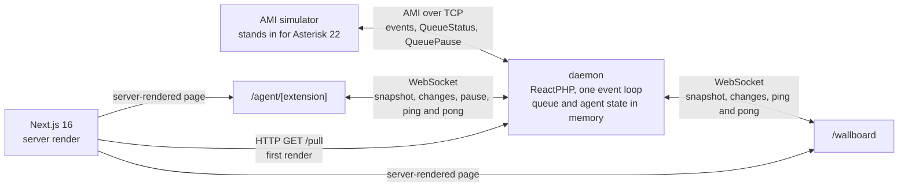

# queue-wallboard

[](https://github.com/typllukas/queue-wallboard/actions/workflows/check.yaml)

A live queue wallboard and agent pages for a fictional contact centre. A learning project, not a product. It
focuses on ReactPHP as a long-running server, the Asterisk Manager Interface (AMI) through which a PBX (the
phone system) reports calls and agents, keeping browsers in sync in real time and detecting pages that stopped
responding, and the contact-centre metrics a supervisor's wallboard is built on: queue load, service levels
(SLA and SVL) and agent availability and pauses.

A ReactPHP daemon keeps the state of queues and agents in memory and sends every change to the browser over
WebSocket. The PBX is a simulator that implements AMI as Asterisk 22 does, built so that a real Asterisk with
the same queues and agents needs only a new address. Two queues, six fictional agents, no database, no login.

**The demo page at Peak**


**How the parts connect**



## Run it

Needs git, GNU Make and Docker Compose.

```sh
git clone https://github.com/typllukas/queue-wallboard.git && cd queue-wallboard && make up
```

Then open <http://localhost:3000>. From a fresh clone `make up` takes about two and a half minutes, plus
downloading the PHP and Node base images the first time. Ports 3000, 8090 and 5039 are published on
127.0.0.1 only. `make check` runs the CI gate, `make down` stops everything, `make help` lists the rest.

Without Make:

```sh
export HOST_UID="$(id -u)" HOST_GID="$(id -g)"
docker compose build
docker compose run --rm --no-deps daemon composer install --no-interaction
docker compose run --rm --no-deps web npm install
docker compose up -d --wait
```

The page at `/` shows the wallboard beside the pages of two fictional agents you play, Petr Svoboda (201) and
Lucie Dvořáková (203); the simulator plays the other four. `/wallboard` and `/agent/201` to `/agent/206` also
open on their own.

### Try it

- **Peak** under *Change the traffic*: support turns red within about a minute and callers abandon
- **Lunch** on Lucie's page: she is counted in both her queues; with callers waiting, **End pause** puts her on the next call at once
- **Separate tabs**: open `/agent/203` twice and `/wallboard` once; a pause pressed in one tab shows in the others at once
- **Close Lucie's page**: 10 s later the daemon pauses her as Inactive, unless another of her pages is still open; **Freeze** it: within 15 s
- **Drop the PBX connection**: the simulator closes the AMI connection for 6 s, every page shows "PBX
  disconnected" for about 8 s, until the daemon reconnects and reloads the state with `QueueStatus`
- `docker compose restart daemon`: the pages reconnect, load the full state again and no agent is paused
- **Long poll**: `curl -s localhost:8090/pull` returns the full state and a `hash`;
  `curl -s 'localhost:8090/pull?hash=<that hash>'` waits until something changes (at most 15 s) and returns
  only what changed

## One long-running process

The AMI client, the queue and agent state, the WebSocket server, the heartbeat and the long poll share one ReactPHP loop
and one copy of the state, so nothing needs a lock or a shared store, and nothing may block. The daemon has no
database and no file I/O once the loop runs.

Memory must not grow while pages keep connecting and disconnecting: a closed connection is removed from every
map, together with its timers and listeners. The daemon logs `memory_get_usage()` once a minute. The one-hour
test below passes when that number stops growing after the first ten minutes of Peak:

```sh
curl -X POST localhost:5039/scenario/peak
docker compose exec -T web node /app/scripts/connection-churn.mjs 3600
docker compose logs daemon | grep -i memory
curl -X POST localhost:5039/scenario/normal
```

A slow screen does not get a queue of old messages: when its buffer is full, the daemon keeps only the newest
state and sends it on `drain`. On SIGTERM the daemon stops the heartbeat first, so shutting down pauses no
agent.

## Talking to Asterisk

After every connect and reconnect the daemon reloads the state with `QueueStatus`, Asterisk's list of queues,
members and callers, and then applies the events that arrived in the meantime. A lost connection is retried
with growing delays of up to 10 s, and an AMI `Ping` every 10 s detects a connection that died without
closing.

Where Asterisk's documentation and `apps/app_queue.c` on branch 22 disagree, the simulator follows the source.
Tests cover three such differences: a `Dest` prefix on the agent's fields, different field names in the
`QueueStatus` reply, and `RingTime` in seconds in one event and milliseconds in another.

The AMI client is written here rather than taken from `clue/ami-react`. The simulator needs the same parser on
its server side, and the library would have covered only login, packet parsing and matching replies to
actions, in untyped code; the reconnect, the `QueueStatus` reload and holding events back during it are
written here either way.

A pause is confirmed by the PBX: the button sends `QueuePause`, and the page shows the agent paused only when
`QueueMemberPause` comes back.

## Detecting a dead page

The browser answers WebSocket protocol pings by itself, even while the page's JavaScript is frozen. So the
daemon sends an application `ping` every 5 s, and the page answers from its own code.

An agent page that has not answered for 10 s is closed, and the agent is paused before a call is routed to a
dead app. A page that closes pauses the agent only if none of their pages reconnects within 10 s, so a reload
pauses no agent. Pages reconnect after a random delay (exponential backoff with full jitter) and load the full
state again, so messages need no sequence numbers. A background tab keeps answering: 96 of 96 pongs over eight
minutes in a hidden tab.

## WebSocket and long poll

Agent pages use WebSocket because traffic goes both ways: a pong every 5 s and pause commands, on a connection
the daemon already holds. The wallboard sends only pongs, but shares the same connection code. An integration
that only reads gets plain HTTP: `GET /pull?hash=` is held up to 15 s and answered with the changes since that
hash. Next.js renders the page on the server from `/pull`, then the page opens the WebSocket.
Each message is validated by a Zod schema that holds only the fields the page uses, and the PHP and TypeScript
tests read the same example message.

## The wallboard

Four widgets: service availability, queue stats, waiting calls and pauses. Service levels are counted per
queue since local midnight, or since the daemon started if that was later, with a 20 s threshold and a 5 s Skip for callers who hang up straight away:

- SVL = Answered ÷ (Total − abandoned within Skip)
- SLA = Answered within 20 s ÷ (Total − abandoned within Skip − abandoned after Skip but within 20 s)

Waiting calls, waiting time and free agents change colour at per-queue thresholds; free agents turn red when
there are too few and orange when there are too many. A call the agent does not answer pauses them as
Inactive, as Asterisk's autopause does, and an unknown pause reason shows as Other, so a paused agent never
counts as free.

## Stack and checks

PHP 8.5 with `react/event-loop`, `react/http` and `ratchet/rfc6455` for the WebSocket protocol, rather than Ratchet,
unreleased since 2021. That library answers no control frames, so the daemon answers Ping and Close itself
(RFC 6455 section 5.5). From Symfony only `console` and `clock`. The frontend is Next.js 16 with TypeScript
and Zod.

`make check` is the CI gate: php-cs-fixer, Rector, PHPStan at level max with strict rules and no baseline,
PHPUnit, `tsc`, ESLint and Vitest. The daemon tests run against real sockets on the real event loop.

## Limits

- Statistics are kept in memory and reset when the daemon restarts; reconnecting to the PBX restores who is
  paused and waiting, not the day's history.
- One daemon, no horizontal scaling.
- No authentication: anyone can open any agent page and pause that agent. A foreign `Origin` is refused, and
  an AMI field with a line break is never written, so no page can inject a second AMI action.
- Not ready for a public network: no reverse proxy in front, AMI in plain text.
